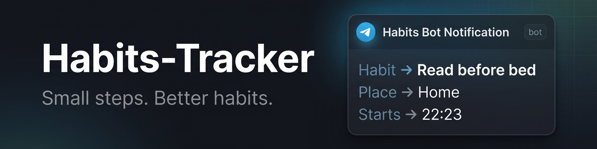
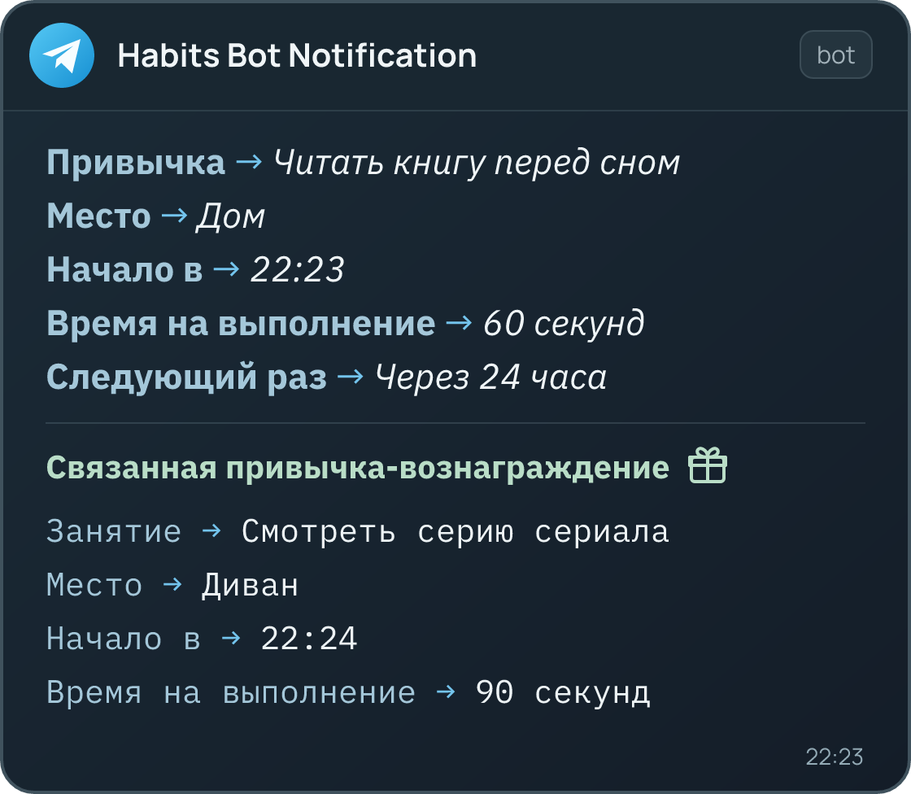

## 📝 О проекте

**Habits-Tracker** — бэкенд SPA-приложения для формирования полезных привычек и отправки напоминаний по мотивам книги Джеймса Клира «Атомные привычки». Пользователи могут указывать место, время и действие, а также выбирать материальное вознаграждение или связанную приятную привычку.

Сервис предоставляет REST API, интегрирован с Telegram-ботом для своевременных уведомлений и позволяет авторизованным пользователям просматривать публичные привычки других пользователей. 
*(Примечание: на данный момент сервис не ведет историю выполнения привычек, а фокусируется на их создании и своевременном напоминании).*

> *Стилизованный пример уведомления в Telegram*

## 🛠️ Возможности проекта

- **Пользователи** — регистрация, JWT-аутентификация и управление своим профилем.
- **Привычки** — создание, просмотр, редактирование и удаление, разделение на полезные и приятные.
- **Проверки данных** — валидация продолжительности, периодичности, вознаграждения и связанной привычки на уровне API.
- **Публичные привычки** — отдельный список привычек других пользователей, доступный после авторизации.
- **Telegram-уведомления** — планирование напоминаний с помощью Celery и Redis.
- **Документация API** — интерактивный Swagger UI и схема OpenAPI.
- **Docker Compose** — PostgreSQL, Redis, Django, Celery worker, Celery beat и Nginx.
- **CI/CD** — линтер, проверки Django и миграций, тесты с coverage и сборка образов.

## 📖 Документация и запуск

Руководство по установке и запуску содержит настройку окружения, запуск через Docker и Poetry, проверку API, инструкции для тестов, демонстрационных данных и CI/CD.

👉 **[Перейти к руководству](docs/SETUP.md)**

## 🔗 Основные маршруты

| Маршрут | Назначение |
| --- | --- |
| `/api/docs/` | Swagger UI |
| `/api/schema/` | Схема OpenAPI |
| `/admin/` | Административный интерфейс Django |
| `/user/create/` | Регистрация пользователя |
| `/token/`, `/token/refresh/` | Получение и обновление JWT |
| `/user/profile/`, `/user/habits/` | Профиль и собственные привычки |
| `/habit/list/`, `/habit/create/`, `/habit/<id>/` | Публичный список, создание и детали привычки |

Маршруты и методы доступны в Swagger UI.

## 📜 Лицензия

Проект распространяется под [лицензией MIT](LICENSE).
